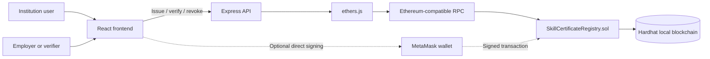

# Proofmark: Blockchain Skill Certificate Verification

Proofmark is a blockchain-backed application for issuing, verifying, and revoking skill certificates. It uses a Solidity smart contract deployed to an Ethereum-compatible local network, an Express API, and a React frontend.

The project demonstrates the following Blockchain course experiments:

1. Cryptographic hashing of certificate data.
2. Smart-contract creation and interaction using Solidity.
3. Blockchain transactions for certificate issuance and revocation.
4. Optional wallet-based signing with MetaMask.
5. Local Ethereum-compatible blockchain execution using Hardhat.

The earlier Merkle-tree experiment was considered but removed from the application because a Merkle root is not required for the core certificate workflow. It is useful for very large batch-issuance systems, but it would add complexity to this project.

## Project objective

Traditional certificates are usually verified through a centralized database or by contacting the issuing institution. Proofmark stores certificate facts and status transitions in a smart contract so that a verifier can check the certificate against a tamper-resistant blockchain record.

The application supports:

- Issuing a certificate.
- Storing certificate and recipient hashes.
- Recording the issuing wallet.
- Recording issue and expiration timestamps.
- Verifying a certificate by ID.
- Revoking a certificate without deleting its history.
- Rejecting unauthorized issuers.
- Optional direct transaction signing through MetaMask.
- A local demo mode that works without MetaMask.
- QR-code generation and camera-based certificate verification.

## Architecture



### Main components

| Component | Location | Responsibility |
| --- | --- | --- |
| Solidity contract | [`contracts/SkillCertificateRegistry.sol`](./contracts/SkillCertificateRegistry.sol) | Enforces certificate rules and stores certificate state. |
| Express application | [`src/app.ts`](./src/app.ts) | Creates the HTTP API and connects routes. |
| Server entry point | [`src/server.ts`](./src/server.ts) | Selects blockchain or in-memory mode and starts the API. |
| Certificate routes | [`src/routes/certificates.ts`](./src/routes/certificates.ts) | Handles issue, verify, and revoke requests. |
| Blockchain adapter | [`src/services/blockchainRegistry.ts`](./src/services/blockchainRegistry.ts) | Uses ethers.js to call the smart contract. |
| In-memory adapter | [`src/services/certificateRegistry.ts`](./src/services/certificateRegistry.ts) | Lightweight fallback used when blockchain mode is disabled. |
| Registry interface | [`src/services/registry.ts`](./src/services/registry.ts) | Keeps the API independent of the storage implementation. |
| React UI | [`frontend/src/App.tsx`](./frontend/src/App.tsx) | Institution portal and public verification screen. |
| Contract tests | [`test/SkillCertificateRegistry.ts`](./test/SkillCertificateRegistry.ts) | Tests contract permissions and certificate behavior. |

## Certificate lifecycle

```mermaid
flowchart TD
    Start([Start]) --> Connect{MetaMask connected?}
    Connect -->|Yes| Wallet[Institution wallet signs transaction]
    Connect -->|No| Demo[Frontend sends request to backend demo wallet]
    Wallet --> Issue[issueCertificate()]
    Demo --> API[POST /api/certificates]
    API --> Issue
    Issue --> Approved{Institution approved?}
    Approved -->|No| Rejected[Transaction rejected]
    Approved -->|Yes| Stored[Certificate stored on blockchain]
    Stored --> Response[Certificate ID returned]
    Response --> Verify[GET /api/certificates/:id/verify]
    Verify --> Status[ACTIVE, EXPIRED, or REVOKED]
    Status --> Revoke{Authorized revocation?}
    Revoke -->|Yes| RevokeTx[revokeCertificate()]
    RevokeTx --> Status
```

## Blockchain concepts demonstrated

### 1. Cryptographic hashing

The application accepts readable values such as:

```text
graduate-001
certificate-document-001
```

Before storing them in the contract, the application converts them to `bytes32` values with Ethereum's Keccak-256 hash:

```ts
keccak256(toUtf8Bytes(value))
```

The hash is a fixed-length fingerprint of the input. A small change to the input produces a different hash.

The application stores:

- `certificateHash`: fingerprint of the certificate document or certificate data.
- `recipientHash`: fingerprint of the graduate identifier.

This avoids storing the original sensitive identifier directly on-chain. Hashing is not encryption: predictable values can sometimes be guessed and hashed again, so real deployments should use suitable high-entropy inputs and privacy controls.

### 2. Smart contracts

A smart contract is a program deployed on the blockchain. Its state and rules are executed by the blockchain network rather than only by the web server.

The contract defines:

- `Certificate` struct for certificate data.
- `Status` enum with `Active` and `Revoked`.
- `certificates` mapping from certificate ID to certificate record.
- `approvedInstitutions` mapping for issuer authorization.
- Events for approval, issuance, and revocation.

Important functions:

```solidity
setInstitutionApproval(address institution, bool approved)
issueCertificate(bytes32 certificateId, ...)
getCertificate(bytes32 certificateId)
revokeCertificate(bytes32 certificateId)
```

### 3. Transactions and calls

Blockchain interactions are either:

- **State-changing transactions**: require a signer, consume gas, and are recorded in a block.
- **Read-only calls**: do not change state and do not require gas.

Examples:

| Operation | Type | Blockchain effect |
| --- | --- | --- |
| `issueCertificate` | Transaction | Creates a certificate record. |
| `revokeCertificate` | Transaction | Changes status to revoked. |
| `setInstitutionApproval` | Transaction | Changes issuer permissions. |
| `getCertificate` | Read-only call | Reads a certificate record. |

### 4. Wallet identity and MetaMask

An Ethereum address identifies a wallet. A private key controls that wallet. MetaMask keeps the private key and asks the user to approve transactions.

When MetaMask is connected, the institution can sign an issuance transaction directly:

```text
Institution browser -> MetaMask -> Smart contract
```

The private key is not sent to the frontend or backend.

MetaMask is required for institution issuance in blockchain mode. The
connected approved institution wallet signs the issuance transaction directly;
the backend is not an issuance relay.

### 5. Access control

The contract uses modifiers:

```solidity
modifier onlyAdministrator()
modifier onlyApprovedInstitution()
```

Only the administrator can approve or remove institutions. Only approved institution addresses can issue certificates. The original issuer or administrator can revoke a certificate.

### 6. Immutability and revocation

Blockchain records are not normally deleted. Revocation changes the certificate status from `Active` to `Revoked`, preserving the fact that the certificate existed and was later invalidated.

This creates an auditable history:

```text
Certificate issued -> Certificate verified -> Certificate revoked
```

## Smart-contract behavior

### Institution approval

The administrator calls:

```solidity
setInstitutionApproval(institutionAddress, true)
```

The contract emits:

```solidity
InstitutionApprovalUpdated(institutionAddress, true)
```

### Certificate issuance

The contract validates:

- The caller is an approved institution.
- The certificate ID is not already used.
- The skill name is not empty.
- The expiration is either zero or in the future.

It then stores:

```solidity
Certificate({
    certificateHash: ...,
    recipientHash: ...,
    skillName: ...,
    issuer: msg.sender,
    issuedAt: block.timestamp,
    expiresAt: ...,
    status: Status.Active
})
```

### Verification

The API reads the certificate from the contract. The application calculates the display status:

```text
REVOKED  if the contract status is revoked
EXPIRED  if the expiration date has passed
ACTIVE   otherwise
```

The current verification response contains:

```json
{
  "valid": true,
  "status": "ACTIVE",
  "certificate": {
    "id": "certificate-id",
    "certificateHash": "0x...",
    "recipientHash": "0x...",
    "skillName": "Blockchain Development",
    "issuer": "0x...",
    "issuedAt": "2026-10-12T13:00:00.000Z",
    "expiresAt": null,
    "revokedAt": null
  }
}
```

### Revocation

The issuer or administrator calls:

```solidity
revokeCertificate(certificateId)
```

The certificate remains in the mapping, but its status changes to `Revoked`.

## API endpoints

Base URL: `http://localhost:3000`

### Health check

```http
GET /health
```

### Issue a certificate

In blockchain mode, institution issuance is performed directly from the
approved institution wallet in MetaMask. The backend `POST` endpoint is not an
issuance relay and returns an error if called in chain mode. It remains
available for in-memory API tests.

```http
POST /api/certificates
Content-Type: application/json
```

Example body:

```json
{
  "certificateHash": "certificate-document-001",
  "recipientHash": "graduate-001",
  "skillName": "Blockchain Development",
  "issuer": "0xf39Fd6e51aad88F6F4ce6aB8827279cffFb92266",
  "expiresAt": null
}
```

### Verify a certificate

```http
GET /api/certificates/:id/verify
```

### Revoke a certificate

```http
POST /api/certificates/:id/revoke
```

## Admin role API

The first role-management slice exposes the administrator operations through the backend service layer. In blockchain mode, these calls are submitted by the configured backend wallet, and the Solidity contract enforces that this wallet is the administrator.

Read the administrator address:

```http
GET /api/admin
```

Check whether an institution is approved:

```http
GET /api/admin/institutions/:address
```

Approve or remove an institution:

```http
PUT /api/admin/institutions/:address
Content-Type: application/json
```

Request body:

```json
{
  "approved": true
}
```

The endpoint does not bypass the contract's `onlyAdministrator` modifier. If the configured backend wallet is not the contract administrator, the blockchain transaction is rejected.

### Institution portal and audit details

The institution portal displays the configured issuer's approval status and
certificate history. Blockchain-mode history is reconstructed from the
`CertificateIssued` contract events, so it remains available after a server
restart.

Successful blockchain issuance, revocation, and institution-approval responses
include transaction metadata:

```json
{
  "hash": "0x...",
  "blockNumber": 7,
  "contractAddress": "0x..."
}
```

In-memory mode now mirrors the contract's access rule: an issuer must first be
approved through the admin API before it can issue a certificate.

### Administrator activity and API protection

The Admin Controls view includes an activity feed built from the contract
events:

```http
GET /api/admin/activity
```

It shows institution approvals, certificate issuance, and certificate
revocation events with their block numbers and transaction hashes.

When `ADMIN_API_KEY` is configured, approval changes require this header:

```http
PUT /api/admin/institutions/:address
x-admin-key: <ADMIN_API_KEY>
```

Requests without the key receive `401 Admin authentication required`.
Read-only administrator and institution status endpoints remain available for
the local demonstration. The API key is intended for local/demo protection;
production deployments should use wallet signature authentication or an
identity provider rather than exposing a static browser key.

## Local setup

### Prerequisites

- Node.js
- npm
- A browser
- Optional: MetaMask

Install dependencies:

```bash
npm install
cd frontend
npm install
cd ..
```

### Start the local blockchain

Open Terminal 1:

```bash
npx hardhat node
```

Keep this terminal running. Hardhat provides funded development accounts and an Ethereum-compatible JSON-RPC endpoint at:

```text
http://127.0.0.1:8545
```

The accounts and private keys printed by Hardhat are for local testing only. Never use them on Mainnet.

### Compile and deploy

Open Terminal 2:

```bash
npm run hardhat:compile
npx hardhat run scripts/deploy.ts --network localhost
```

Copy the deployed contract address printed by the command.

### Approve the demo institution

The administrator must approve the wallet used to issue certificates:

```bash
INSTITUTION_ADDRESS=YOUR_INSTITUTION_ADDRESS \
CONTRACT_ADDRESS=YOUR_CONTRACT_ADDRESS \
npx hardhat run scripts/approve-institution.ts --network localhost
```

The configured backend wallet deploys and administers the contract. Institution
issuance uses the approved wallet connected through MetaMask. Do not commit
private keys or real credentials.

### Configure environment variables

Create `.env` in the project root:

```env
PORT=3000
BLOCKCHAIN_MODE=chain
RPC_URL=http://127.0.0.1:8545
CONTRACT_ADDRESS=YOUR_CONTRACT_ADDRESS
BACKEND_PRIVATE_KEY=YOUR_LOCAL_DEVELOPMENT_PRIVATE_KEY
ADMIN_API_KEY=YOUR_LOCAL_ADMIN_KEY
```

Create `frontend/.env`:

```env
VITE_CONTRACT_ADDRESS=YOUR_CONTRACT_ADDRESS
VITE_DEMO_ISSUER_ADDRESS=YOUR_BACKEND_WALLET_ADDRESS
VITE_ADMIN_API_KEY=YOUR_LOCAL_ADMIN_KEY
```

The `.env` files are ignored by Git. Keep private keys only in local environment files or a secure secret manager.

### Start the backend

Open Terminal 3:

```bash
npm run dev
```

The API runs at:

```text
http://localhost:3000
```

### Start the frontend

Open Terminal 4:

```bash
cd frontend
npm run dev
```

Open:

```text
http://127.0.0.1:5173
```

## Presentation demonstration

### Demonstration 1: Issue a certificate

1. Open the frontend.
2. Select **Institution portal**.
3. Connect the approved institution wallet through MetaMask.
4. Enter:

```text
Skill or course name: Blockchain Development
Graduate identifier hash: graduate-001
Certificate document hash: certificate-document-001
```

5. Click **Issue certificate** and approve the MetaMask transaction.
6. The connected institution wallet sends the `issueCertificate` transaction.
7. The page displays the generated certificate ID.

### Demonstration 2: Verify the certificate

1. Copy the certificate ID.
2. Select **Verify a certificate**.
3. Paste the ID.
4. Click **Verify**.
5. Show:

```text
ACTIVE
Verified on registry
```

Explain that the API is reading the certificate from the smart contract, not from a normal application database.

### Demonstration 3: Revoke the certificate

1. Return to the Institution portal.
2. Click **Revoke certificate**.
3. Verify the same ID again.
4. Show:

```text
REVOKED
Not currently valid
```

Explain that the record was not deleted. The blockchain retains the certificate record and its status transition.

### Demonstration 4: Manage institutions as administrator

1. Select **Admin controls**.
2. Confirm that the administrator wallet is displayed.
3. Enter an institution wallet address.
4. Click **Check status**.
5. Click **Approve institution** and show the transaction hash and block number.
6. Click **Remove approval**, then approve it again for the remaining demo.
7. Open the **Administrator activity** feed.
8. Filter by `Institution approvals` and search for the institution address.

Explain the role separation:

- The administrator manages which institutions may issue certificates.
- Approved institutions issue certificates.
- The public can verify certificates without administrator access.
- The smart contract enforces approval independently of the frontend.

### Demonstration 5: Show the activity audit trail

In **Admin controls**, use the activity feed to show:

- Institution approval events.
- Certificate issuance events.
- Certificate revocation events.
- The actor wallet, block number, and transaction hash.

Use the event-type filter to switch between approval, issuance, and revocation.
Use the search box to find a certificate ID or transaction hash. This is the
strongest evidence that the application is recording blockchain state changes
rather than only changing frontend labels.

### Demonstration 6: Show expiration

For a separate certificate, choose a future expiration date. After the date passes, verification reports `EXPIRED`. The contract rejects an expiration date that is already in the past at issuance time.

### Demonstration 7: Show MetaMask signing

MetaMask is required for institution issuance in blockchain mode:

1. Add a local MetaMask network:

```text
Network: Hardhat Local
RPC URL: http://127.0.0.1:8545
Chain ID: 31337
Currency: ETH
```

2. Import a funded Hardhat development account.
3. Approve that address with `scripts/approve-institution.ts`.
4. Open the frontend in the same browser as MetaMask.
5. Click **Connect MetaMask**.
6. Issue a certificate and approve the transaction in MetaMask.

If an unapproved wallet is connected, the issue form remains disabled. The
smart contract also rejects direct attempts from unapproved wallets.

Always check that MetaMask is on **Hardhat Local**, not Ethereum Mainnet. Local Hardhat accounts and contract addresses are for development only.

### Demonstration 8: Verify with a QR code

After issuing a certificate, the institution card displays a QR code containing a URL like:

```text
http://127.0.0.1:5173/?certificateId=certificate-id
```

The QR code contains only the certificate ID and verification URL. It does not contain the certificate's private data. Scanning the code opens the verification page, which calls the existing verification API and reads the current status from the blockchain.

To test the camera scanner:

1. Open the frontend in a browser that can access a camera.
2. Select **Verify a certificate**.
3. Click **Scan QR code**.
4. Allow camera permission.
5. Point the camera at the QR code shown on an issued certificate.

The page extracts `certificateId` from the scanned URL and displays `ACTIVE`, `EXPIRED`, or `REVOKED`. Camera access generally requires `localhost`, `127.0.0.1`, or HTTPS.

## Five-minute presentation checklist

Use this sequence when demonstrating the project:

1. Start Hardhat and deploy the contract.
2. Approve the demo issuer wallet.
3. Start the backend and frontend.
4. Open **Admin controls** and show the administrator address.
5. Approve an institution and point out its transaction hash and block number.
6. Open **Institution portal** and show `Approved`.
7. Issue one certificate.
8. Copy its certificate ID and verify it as `ACTIVE`.
9. Return to the institution portal and revoke it.
10. Verify the same ID as `REVOKED`.
11. Return to **Admin controls**, filter activity by certificate revocation, and show the immutable event trail.

Presentation talking points:

- Hashes identify certificate data without storing the original document.
- The smart contract enforces institution approval and certificate rules.
- Issuance and revocation are blockchain transactions.
- Verification is read-only and can be performed by anyone with the ID.
- Revocation changes status; it does not erase the historical record.
- The backend API is a convenience layer, while the contract is the authoritative registry.

## Troubleshooting the local demo

| Symptom | Check |
| --- | --- |
| `EADDRINUSE` on port 8545 | A Hardhat node is already running; do not start a second one. |
| `could not decode result data` | The configured contract address belongs to a different chain state; redeploy and update both `.env` files. |
| `Institution is not approved` | Approve the exact issuer wallet used by the backend or MetaMask. |
| `401 Admin authentication required` | Set matching `ADMIN_API_KEY` and `VITE_ADMIN_API_KEY`, then restart both servers. |
| MetaMask warns about risk | Confirm the network is Hardhat Local with chain ID `31337`, never Mainnet. |
| QR link does not open on a phone | `127.0.0.1` refers to the scanning device; use a shared LAN/HTTPS URL for cross-device testing. |

## Testing and validation

Run the contract and API tests:

```bash
npm test
```

Build the backend:

```bash
npm run build
```

Build the frontend:

```bash
cd frontend
npm run build
```

The tests cover:

- Approved institution issuance.
- Rejection of unapproved issuance.
- Administrator approval and removal.
- Rejection of admin mutations without the API key.
- Administrator activity retrieval.
- Issuer revocation.
- Future expiration storage.
- API issuance and verification.
- API expiration status.
- API revocation status.

## Experiment mapping

| Course experiment | Implementation in this project |
| --- | --- |
| Merkle tree and cryptographic hash | Cryptographic hash is implemented for certificate and recipient values. Merkle batching was intentionally removed because it is optional for this use case. |
| Solidity smart contract using Remix | [`SkillCertificateRegistry.sol`](./contracts/SkillCertificateRegistry.sol) can be compiled and inspected in Remix or Hardhat. |
| Solidity transactions | Issuance, approval, and revocation are state-changing blockchain transactions. |
| Transactions using an embedded wallet | Optional MetaMask flow signs issuance directly in the browser. |
| Ethereum using Geth | The same ethers/RPC design can connect to Geth by changing `RPC_URL`; the current demonstration uses Hardhat. |
| Ganache implementation | Hardhat provides the local Ethereum-compatible development network; Ganache can be substituted with a compatible RPC URL. |
| Hyperledger case study | Not implemented in code; suitable as a comparison section in the presentation. |
| Other blockchain case study | Not implemented in code; Ethereum-compatible smart contracts were selected for the working prototype. |

## Centralized versus decentralized parts

### Blockchain-backed

- Certificate state in chain mode.
- Certificate issue and revoke transactions.
- Issuer address recorded by the contract.
- Smart-contract access rules.
- Blockchain timestamps.
- Immutable transaction history.

### Centralized or configurable

- Express API endpoint.
- Frontend hosting.
- RPC provider configuration.
- Administrator account.
- Institution approval process.
- Local demo backend wallet.

The accurate description is:

> Proofmark is a blockchain-backed certificate verification system with Solidity-enforced authorization and optional MetaMask-signed issuance. It is not completely decentralized because the API, administrator, and institution approval process remain centralized control points.

## Presentation talking points

### Problem

Paper and database-backed certificates can be forged, altered, or difficult to verify across institutions.

### Proposed solution

Store certificate hashes, issuer identity, timestamps, and status in a smart contract. Allow anyone with a certificate ID to verify the record.

### Why blockchain?

- Shared tamper-resistant ledger.
- Verifiable history.
- No need to trust a single editable certificate database.
- Cryptographic identity through wallet addresses.
- Smart contracts enforce rules consistently.

### Why hashes?

Hashes provide compact integrity fingerprints while avoiding direct storage of the original certificate document and recipient identifier.

### Why a smart contract?

The contract enforces:

- Only approved institutions can issue.
- Certificate IDs cannot be reused.
- Expiration must be valid.
- Only the issuer or administrator can revoke.

### Why MetaMask?

MetaMask demonstrates that an institution can sign a transaction with its own wallet without sharing its private key with the backend.

### Why Hardhat?

Hardhat provides a fast, free local Ethereum-compatible blockchain with test accounts, mining, deployment, and automated contract tests.

## Limitations and future enhancements

Current limitations:

- The local blockchain resets when the Hardhat node is stopped.
- The local demo wallet is appropriate only for development.
- The API does not yet provide authentication or rate limiting.
- Certificate hashes are integrity identifiers, not encryption.
- The administrator remains a trusted authority.

Possible future features:

- PDF certificate generation.
- Transaction hash and block-number display.
- Admin dashboard for institution approval.
- Event-based audit history.
- Production wallet and key management.
- Deployment to a public testnet.
- Hyperledger Fabric comparison or implementation.

## Useful commands

```bash
# Compile Solidity
npm run hardhat:compile

# Start local blockchain
npx hardhat node

# Deploy contract to local blockchain
npx hardhat run scripts/deploy.ts --network localhost

# Approve an institution
INSTITUTION_ADDRESS=... CONTRACT_ADDRESS=... \
npx hardhat run scripts/approve-institution.ts --network localhost

# Start backend
npm run dev

# Start frontend
cd frontend && npm run dev

# Run tests
npm test

# Build backend
npm run build

# Build frontend
cd frontend && npm run build
```
